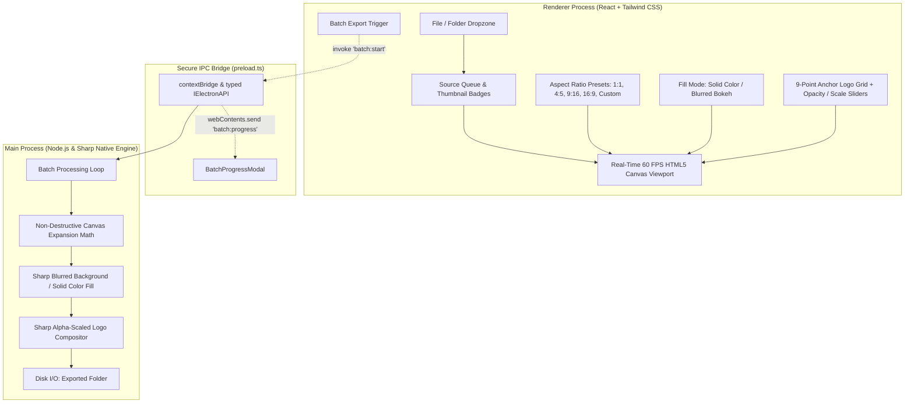

# Photoframer ✦

> Modern, non-destructive batch image aspect ratio padding and transparent watermark studio for desktop, engineered with Electron, TypeScript, Sharp, and React.

---

## ✦ System Architecture & Design Philosophy

Photoframer is designed for creative media workflows, photographers, and social media producers who need to standardize image aspect ratios for platforms (e.g. Instagram 1:1 / 4:5, TikTok / Reels / Shorts 9:16, YouTube 16:9, or custom print ratios) without ever cropping or losing original image detail.



### Key Engineering Pillars
1. **Zero-Destruction Guarantee:** Original image pixels are never cropped or shrunk. The canvas expands in height (letterbox) or width (pillarbox) to fit the target ratio, perfectly centering the source image.
2. **Dual-Fill Background Engine:**
   - **Solid Color Fill:** Pitch Black (`#000000`), Pure White (`#ffffff`), Studio Slate (`#12151b`), or custom hex with live palette swatches.
   - **Blurred Canvas Fill:** Generates an artistic bokeh backdrop by scaling and blurring the original image (`sigma: 20-50`), creating a sleek, premium social media post aesthetic.
3. **9-Point Watermark Compositor:** Real-time 9-anchor positioning (Top-Left, Top-Center, Top-Right, Middle-Left, Center, Middle-Right, Bottom-Left, Bottom-Center, Bottom-Right) with canvas-proportional scaling (5% to 50%), per-pixel alpha channel transparency modulation (10% to 100%), and safe edge margins (0% to 15%).
4. **Sandboxed IPC Security:** Strict Electron security configuration:
   - `nodeIntegration: false`
   - `contextIsolation: true`
   - Custom `app-img://` privileged protocol for local asset display without disabling web security.
   - Strict Content Security Policy (CSP) headers applied to all sessions.
5. **Fluid Modern UX:**
   - Multi-tier surface elevations (`--bg-base`, `--bg-panel`, `--bg-card`, `--bg-elevated`).
   - Tactile 9-point anchor matrix with cyan glow indicators.
   - Real-time 60 FPS HTML5 Canvas preview for instant visual feedback during slider adjustment.
   - "Hold to Preview Original" A/B split-second comparison.

---

## 📁 Project Structure

```
photoframer/
├── src/
│   ├── main/
│   │   ├── main.ts               # Electron window lifecycle, protocol handlers, IPC listeners
│   │   ├── imageProcessor.ts     # Sharp compositing engine, ratio calculations, batch runner
│   │   └── types.ts              # Shared domain models & interfaces
│   ├── preload/
│   │   └── preload.ts            # contextBridge typed API exposed to window.electronAPI
│   └── renderer/
│   │   ├── main.tsx              # React 18 DOM mount point
│   │   ├── App.tsx               # Studio 3-column workspace & state management
│   │   ├── index.css             # Tailwind CSS & UI design tokens
│   │   ├── types.ts              # Renderer-specific types and window interface
│   │   ├── components/
│   │   │   ├── Header.tsx        # Top status bar, theme switch, batch action trigger
│   │   │   ├── SourceList.tsx    # Drag-and-drop zone, loaded list with orientation badges
│   │   │   ├── AspectControl.tsx # Presets (1:1, 4:5, 9:16, 16:9, Custom) & Fill selector
│   │   │   ├── WatermarkControl.tsx # 9-point grid, scale, opacity, margin controls
│   │   │   ├── ExportSettingsControl.tsx # Format, compression quality, folder picker
│   │   │   ├── PreviewPane.tsx   # Interactive canvas viewport with zoom & comparison
│   │   │   └── BatchProgressModal.tsx # Progress bar, stats counter, "Open Folder"
│   │   └── utils/
│   │       ├── canvasRenderer.ts # Client-side 60 FPS preview renderer matching Sharp
│   │       └── formatters.ts     # Byte formatters, dimension formatters
├── sample-assets/                # Bundled test images (landscape, portrait, square, logo)
├── scripts/
│   ├── dev-runner.js             # Development coordinator (Vite + Electron)
│   ├── generate-sample-assets.js # Generates test photos and transparent SVG/PNG logo
│   └── test-batch-pipeline.js    # Automated Sharp processing verification test suite
├── package.json
├── tsconfig.json
├── vite.config.ts                # Vite renderer bundler
├── vite.config.main.ts           # Vite Node/Electron CJS bundler for main & preload
└── tailwind.config.js            # Tailwind theme palette configuration
```

---

## 🚀 Quick Start & Development

### 1. Installation
```bash
# Clone or navigate to the project directory
cd Photoframer

# Install dependencies (Node 18+ required)
npm install
```

### 2. Run Verification Tests & Generate Sample Assets
```bash
# Generate sample test photos and transparent watermark PNG
npm run generate:samples

# Run automated batch processing pipeline verification test
npm run test:pipeline
```

### 3. Run Development Server
```bash
# Launches Vite dev server and spawns Electron with hot-reloading
npm run dev
```

### 4. Build for Production
```bash
# Builds renderer (dist/renderer) and Electron main/preload (dist/main, dist/preload)
npm run build

# Launch the production bundle with Electron
npm start
```

---

## 🎨 UI Design System & Aesthetic

The application adheres to modern, sleek studio design principles:
- **Surface Depth Hierarchy:** Elevated obsidian (`#0a0c0f`) base, dark slate (`#111419`) panels, card surfaces (`#171b22`), and flyouts (`#1e232d`) with delicate `1px rgba(255,255,255,0.08)` borders.
- **Micro-Interactions:** Smooth glow animations on active states, hover lift on preset cards, tactile feedback on slider knobs, and animated drag-over zones.
- **Theme Adaptability:** Full Dark and Light mode support dynamically switching CSS custom properties across all components.
- **High Scannability:** Orientation tags (`Landscape`, `Portrait`, `Square`), format chips (`JPG`, `PNG`, `WEBP`), and live resolution transformation metrics (`3840×2160 → 3840×3840`).

---

## 📄 License
MIT © Nipuna
